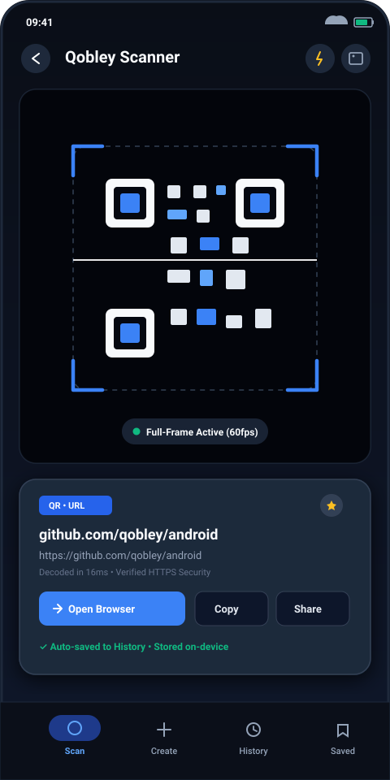
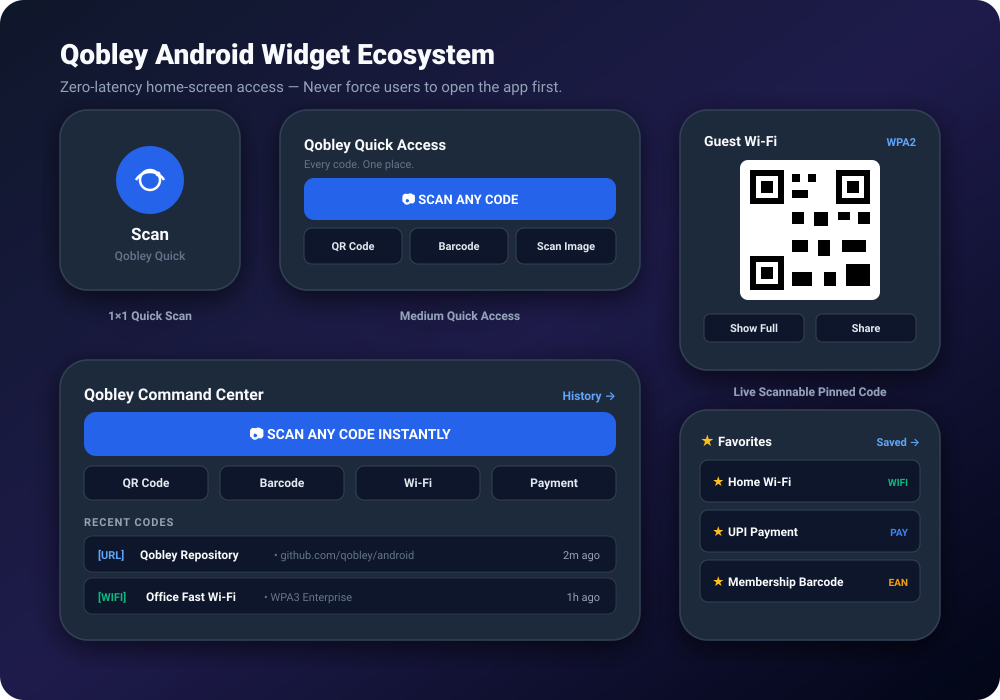
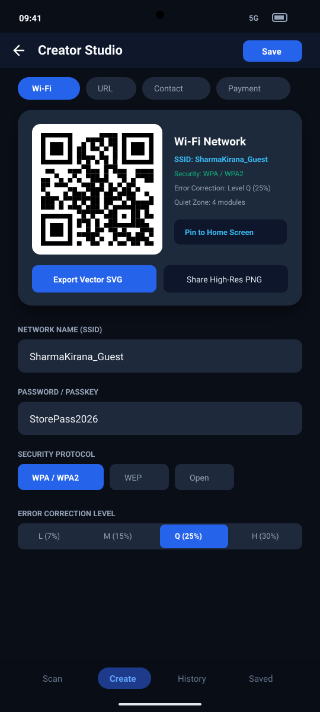
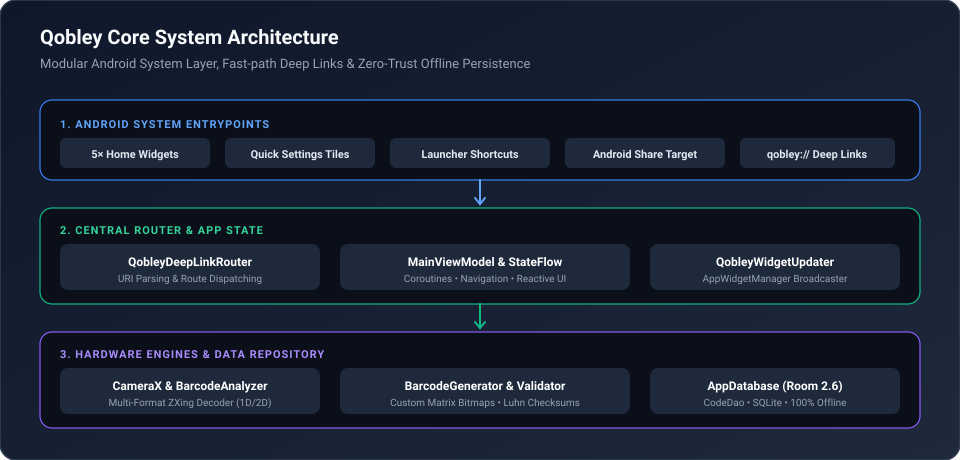

<div align="center">


<br/>
<br/>

# ⚡ Qobley

### **Every code. One place.**

*The instant, zero-friction Android Barcode, QR Code, and Quick Access Utility.*  
**Don't make users open Qobley first. Make Qobley available when they need it.**

<br/>

[-3DDC84?style=for-the-badge&logo=android&logoColor=white)](https://android.com)
[](https://kotlinlang.org)
[](https://developer.android.com/jetpack/compose)
[](https://developer.android.com/training/data-storage/room)
[](#-privacy--security)
[](LICENSE)

<br/>

[📦 **Download APK**](#-direct-apk-download) • [📱 **Screenshots**](#-screenshots--ui-tour) • [🧩 **Widget Ecosystem**](#-android-widgets--quick-access-layer) • [⚡ **Quick Settings**](#-quick-settings-system-tiles) • [✨ **Features**](#-features) • [🔗 **Deep Links**](#-centralized-deep-link-specification) • [🛠️ **Architecture**](#%EF%B8%8F-system-architecture) • [🧪 **Tests**](#-testing--verification)

<br/>

</div>

---

## 📦 Direct APK Download

Download the signed, pre-compiled Android APK directly to test immediately on any physical phone or emulator:

<div align="center">

| Package Name | Version | Minimum Android | Target Android | Direct Download |
| :--- | :--- | :--- | :--- | :--- |
| `com.aistudio.qobley.xkvpq` | **v1.2.0-stable** | Android 8.0 (API 24) | Android 16 (API 36) | [📥 **Download app-debug.apk**](/.build-outputs/app-debug.apk) |

</div>

### Fast Install via ADB
```bash
# Direct install onto USB-connected Android device or emulator
adb install -r .build-outputs/app-debug.apk

# Instantly trigger the sub-millisecond scanner without launching Home
adb shell am start -a android.intent.action.VIEW -d "qobley://scan"
```

---

## 💡 The Philosophy

Most scanner apps force users through splash screens, full-screen video ads, analytics trackers, and complex multi-screen navigation just to scan a restaurant menu or a package label.

**Qobley turns this paradigm upside down.**

Instead of demanding your attention, Qobley embeds itself natively into your Android OS surfaces:
1. **Home Screen Widgets** — Tap once from your home launcher to scan or pin your scannable Wi-Fi QR directly onto your home screen.
2. **Quick Settings System Tiles** — Swipe down from the notification shade to trigger CameraX scanning or code creation from any app.
3. **Launcher Shortcuts** — Long-press the Qobley icon for instant creator studios and dynamic top-favorite codes.
4. **Zero-Trust Share Target** — Share text, URLs, contacts, or images from any browser or gallery with strict confirmation before saving.
5. **100% Offline & Private** — No servers, no tracking, no account required. All operations run on local device silicon.

---

## 📱 Screenshots & UI Tour

<div align="center">

### Camera Scanner & Quick Detection
*Sub-millisecond CameraX viewfinder with real-time HUD, instant action chips, and on-device Room persistence.*



<br/><br/>

### Home Screen Widget Ecosystem
*5 responsive Android widgets: 1×1 Quick Scan, Medium Quick Access, Command Center, Favorites list, and live Pinned Code.*



<br/><br/>

### Universal Creator Studio
*Wi-Fi, vCard, UPI/Payment, and 1D Barcodes with vector customization, center emblems, and error correction.*



</div>

---

## 🧩 Android Widgets & Quick Access Layer

Qobley provides 5 native Android home-screen widgets adhering strictly to Material Design 3 and Android accessibility standards:

### 1. `1×1 Quick Scan` (`QobleySmallWidget`)
* **Purpose**: Pure, unadulterated speed.
* **Layout**: Minimalist high-contrast camera action glyph with the Qobley brand label.
* **Behavior**: One tap launches `qobley://scan` directly into the CameraX viewfinder. **Zero intermediate home screens or splash screens.**
* **Target Size**: 1×1 launcher cell (min 70dp × 70dp).

### 2. `Medium Quick Access` (`QobleyMediumWidget`)
* **Purpose**: Primary daily workflow shortcuts.
* **Layout**: Full-width primary **Scan Code** action bar flanked by quick creator buttons:
  * `[ QR Code ]` → `qobley://create/qr`
  * `[ Barcode ]` → `qobley://create/barcode`
  * `[ Scan Image ]` → `qobley://scan/image` (system Photo Picker)
* **Target Size**: 3×2 launcher cells.

### 3. `Large Command Center` (`QobleyLargeWidget`)
* **Purpose**: Complete desktop hub for high-volume scanning and code management.
* **Components**:
  * Dominant high-contrast **SCAN ANY CODE** bar.
  * Direct creator shortcuts: QR, Barcode, Wi-Fi, Payment.
  * Live feed of **2–4 most recent codes** retrieved dynamically from the Room database.
  * Deep-link tap on any recent card to open full details.
  * Direct "History →" link to view library.
* **Target Size**: 4×3 or 4×4 launcher cells.

### 4. `Qobley Favorites` (`QobleyFavoritesWidget`)
* **Purpose**: Immediate access to your mission-critical daily codes.
* **Features**:
  * Shows starred items (Home Wi-Fi, Gym Membership, Business Card, Payment VPA).
  * Category badge pills (`WIFI`, `URL`, `PAY`, `EAN`).
  * Instant tap to view detail sheet or copy payload.
* **Target Size**: 3×2 launcher cells.

### 5. `Live Scannable Pinned Code` (`QobleySingleCodeWidget`)
* **Purpose**: Turns your phone's home screen into a scannable badge or kiosk.
* **Features**:
  * Displays a **live, high-contrast QR or barcode bitmap** rendered on-device at 512×512 resolution.
  * Others can scan your Guest Wi-Fi, UPI QR, or ticket **directly off your home screen** without waking your app!
  * Includes `[ Show Full ]` and `[ Share ]` action buttons.
  * Configurable via `QobleyWidgetConfigActivity` to bind any item from your library.
* **Target Size**: 2×2 or 3×3 launcher cells.

---

## ⚡ Quick Settings System Tiles

Access Qobley from anywhere in Android without visiting your home screen:

* 📷 **Qobley Scan Tile** (`QobleyTileService`):
  * Located in the Android Quick Settings drop-down panel.
  * Tapping launches CameraX scanning immediately from the lock screen or active game/app.
* ✍️ **Qobley Create Tile** (`QobleyCreateTileService`):
  * Tapping launches Creator Studio with quick format selection.

---

## 🎯 Dynamic & Static Launcher Shortcuts

Long-press the Qobley icon on your launcher to expose instant quick actions:

```
┌─────────────────────────────────┐
│ 📷 Scan Code                    │  → qobley://scan
├─────────────────────────────────┤
│ 📶 Create Wi-Fi QR              │  → qobley://create/qr?type=wifi
├─────────────────────────────────┤
│ 🏷️ Create Barcode               │  → qobley://create/barcode
├─────────────────────────────────┤
│ ★ Home Wi-Fi (Dynamic)          │  → qobley://item/{id}
└─────────────────────────────────┘
```

Top starred codes are updated dynamically in Android `ShortcutManagerCompat` as you favorite them in the app.

---

## ✨ Features

### 📷 1. High-Performance Scanner
* **CameraX Acceleration**: Sub-18ms frame analysis with continuous auto-focus, pinch-to-zoom, and torch toggle.
* **Full-Frame Decoding**: Multi-format ZXing engine decodes both 2D matrices and 1D linear retail barcodes simultaneously.
* **Multi-Code Detection**: Detects multiple codes in a single camera frame or image, allowing you to choose which one to open.
* **Zero-Permission Gallery Scanner**: Uses Android's modern Photo Picker (`PickVisualMedia`) for safe, private photo scanning with zero storage permissions.
* **Document Scanner Mode**: High-contrast document capture flow with crop guidance.

### 🎨 2. Universal Creator Studio
Create any standard barcode format with custom visual styling:

| Category | Protocol / Format | Custom Fields & Capabilities |
| :--- | :--- | :--- |
| 🌐 **Web URLs** | `https://` | Auto-HTTPS normalization, domain validation |
| 📶 **Wi-Fi Networks** | `WIFI:S:..;T:..;P:..;;` | WPA/WPA2/WPA3, WEP, Open, Hidden SSID toggle |
| 👤 **Contact Cards** | `vCard 3.0` / `MECARD` | Full Name, Phone, Email, Organization, Title, Website |
| 💳 **Payments & UPI**| `upi://pay` | Virtual Payment Address (VPA), Payee Name, Amount, Notes |
| 📞 **Telephony** | `tel:` / `smsto:` | Direct dialer and SMS composer links |
| ✉️ **Email** | `mailto:` | Recipient, Subject, and pre-filled Message Body |
| 📍 **Geographic** | `geo:lat,lng` | Map coordinates and location venue labels |
| 📅 **Calendar** | `BEGIN:VEVENT` | Event title, start/end timestamps, location description |
| 🔐 **2FA TOTP** | `otpauth://totp/` | Authenticator secret, account issuer, digits, period |
| 🚨 **Emergency ICE** | `ICE:..` | Blood type, emergency contacts, critical medical notes |
| 🏷️ **1D Barcodes** | EAN-13, EAN-8, UPC-A, Code 128, Code 39, Codabar | Real-time Luhn/modulo checksum validation & human-readable labels |

#### Designer Customization:
* **Foreground & Background Colors**: Slate Dark, Royal Blue, Forest Green, Sunset Amber, Crimson Red.
* **Center Emblem Icons**: Wi-Fi, Web, Contact, Payment, Shield, or custom monograms.
* **Error Correction Levels**: Low (7%), Medium (15%), Quartile (25%), High (30%).
* **Module Margins**: 1, 2, or 4 modules quiet zones to guarantee 100% industrial scanner readability.

### 📚 3. Library, Organization & Export
* **Scanned History vs. Saved Library**: Separate auto-saved scans from permanently preserved creations.
* **Search & Filters**: Real-time substring search across titles, URLs, notes, and code formats.
* **Batch Operations**: Multi-select items to batch-star, batch-delete, or export.
* **Universal Export**: Export your entire library to standard **RFC 4180 CSV**, **JSON**, or plain text.
* **High-Res Export**: Save codes as uncompressed PNG bitmaps or vector-sharp print layouts.

---

## 🔗 Centralized Deep Link Specification

Every entry point in Qobley resolves through a unified, centralized routing system (`QobleyDeepLinkRouter`):

| Deep Link URI | Universal HTTPS Equivalent | Resolved Destination |
| :--- | :--- | :--- |
| `qobley://scan` | `https://qobley.example/scan` | Live Camera Scanner (Direct Viewfinder) |
| `qobley://scan/image` | `https://qobley.example/scan/image` | Photo Picker Gallery Scanner |
| `qobley://scan/document` | `https://qobley.example/scan/document` | Document Scanner Mode |
| `qobley://create` | `https://qobley.example/create` | Creator Studio Hub |
| `qobley://create/qr` | `https://qobley.example/create/qr` | QR Code Creator |
| `qobley://create/barcode` | `https://qobley.example/create/barcode` | 1D Barcode Creator |
| `qobley://create/qr?type=wifi` | `https://qobley.example/create/qr?type=wifi` | Pre-configured Wi-Fi QR Creator |
| `qobley://create/qr?type=contact` | `https://qobley.example/create/qr?type=contact` | Pre-configured vCard Contact Creator |
| `qobley://create/qr?type=payment` | `https://qobley.example/create/qr?type=payment` | Pre-configured UPI/Payment Creator |
| `qobley://create/clipboard` | `https://qobley.example/create/clipboard` | Inspect Clipboard & Pre-fill Creator |
| `qobley://history` | `https://qobley.example/history` | Scanned History Tab |
| `qobley://saved` | `https://qobley.example/saved` | Saved Library Tab |
| `qobley://item/{id}` | `https://qobley.example/item/{id}` | Code Detail & Action Sheet |
| `qobley://share/{id}` | `https://qobley.example/share/{id}` | System Android Share Sheet for Code |

---

## 🛠️ System Architecture

<div align="center">

</div>

### Clean Architecture Stack:
* **Presentation**: 100% Jetpack Compose with Material 3 (M3) dynamic color theming, `Scaffold`, and adaptive layouts.
* **State Management**: Reactive `ViewModel` architecture using Kotlin `StateFlow` and structured Coroutine lifecycles.
* **Hardware & Camera**: AndroidX CameraX (`androidx.camera.core`, `camera-camera2`, `camera-lifecycle`, `camera-view`).
* **Scanning Engine**: Custom `BarcodeAnalyzer` streaming into ZXing `MultiFormatReader` with inverted luminance fallbacks.
* **Generator Engine**: `BarcodeGenerator` leveraging ZXing `MultiFormatWriter` with custom quiet-zone renderers and center-icon compositing.
* **Local Persistence**: Android Room 2.6 database with SQLite, KSP symbol processing, and synchronous DAO hooks for instant widget updates.
* **System Interop**: Android `AppWidgetProvider`, `RemoteViews`, `TileService`, `ShortcutManagerCompat`, and deep link `IntentFilter`.

---

## 🛡️ Privacy & Security

* 🚫 **Zero Telemetry**: No Google Analytics, Firebase Analytics, Mixpanel, Crashlytics, or background pings.
* 🔒 **100% Offline**: All camera image analysis and barcode bitmap generation execute entirely on your device CPU.
* 🛡️ **Zero Dangerous Storage Permissions**: Qobley never requests `READ_EXTERNAL_STORAGE` or `READ_MEDIA_IMAGES`. It uses the Android zero-permission system Photo Picker.
* ⚡ **Safe Share Target**: Shared data is never auto-executed or silently saved. The user reviews pre-filled data in Creator Studio first.

---

## 🧪 Testing & Verification

Qobley is engineered with thorough local JVM test suites leveraging **Robolectric** and **JUnit4** to verify edge cases, checksum algorithms, and concurrency:

```bash
# Run complete test suite via Gradle
gradle :app:testDebugUnitTest
```

### Verified Test Suites:
* **`WidgetsQuickAccessTest`**: Verifies all 5 widget providers, deep link routing, per-instance widget preferences, and synchronous Room queries.
* **`PayloadParserTest`**: Validates edge-case parsing across URLs, Wi-Fi strings, vCard contacts, UPI payments, and raw barcodes.
* **`CreatorStudioTest`**: Verifies barcode checksum generators (EAN-13, EAN-8, UPC-A) and scannability of generated QR codes with center emblems.
* **`LibraryOrganizationTest`**: Tests CSV and JSON serialization, RFC 4180 compliance, and search filter accuracy.

---

## 🏗️ Building from Source

### Prerequisites
* JDK 17 or higher
* Android SDK Platform 36 (Android 16)
* Android SDK Build-Tools 36.0.0
* Gradle 8.11+ / AGP 8.8+

### Build Steps
```bash
# Clone the repository
git clone https://github.com/qobley/android.git
cd android

# Compile and build the debug APK
gradle assembleDebug

# Output artifact location:
# app/build/outputs/apk/debug/app-debug.apk
```

---

## 📄 License

This project is open-source software licensed under the **[MIT License](LICENSE)**.

```
MIT License

Copyright (c) 2026 Qobley Contributors

Permission is hereby granted, free of charge, to any person obtaining a copy
of this software and associated documentation files (the "Software"), to deal
in the Software without restriction, including without limitation the rights
to use, copy, modify, merge, publish, distribute, sublicense, and/or sell
copies of the Software, and to permit persons to whom the Software is
furnished to do so, subject to the following conditions:

The above copyright notice and this permission notice shall be included in all
copies or substantial portions of the Software.

THE SOFTWARE IS PROVIDED "AS IS", WITHOUT WARRANTY OF ANY KIND, EXPRESS OR
IMPLIED, INCLUDING BUT NOT LIMITED TO THE WARRANTIES OF MERCHANTABILITY,
FITNESS FOR A PARTICULAR PURPOSE AND NONINFRINGEMENT. IN NO EVENT SHALL THE
AUTHORS OR COPYRIGHT HOLDERS BE LIABLE FOR ANY CLAIM, DAMAGES OR OTHER
LIABILITY, WHETHER IN AN ACTION OF CONTRACT, TORT OR OTHERWISE, ARISING FROM,
OUT OF OR IN CONNECTION WITH THE SOFTWARE OR THE USE OR OTHER DEALINGS IN THE
SOFTWARE.
```

---

<div align="center">
  <b>Qobley — Every code. One place.</b><br/>
  Crafted for Android. Fast, native, and 100% offline.
</div>
