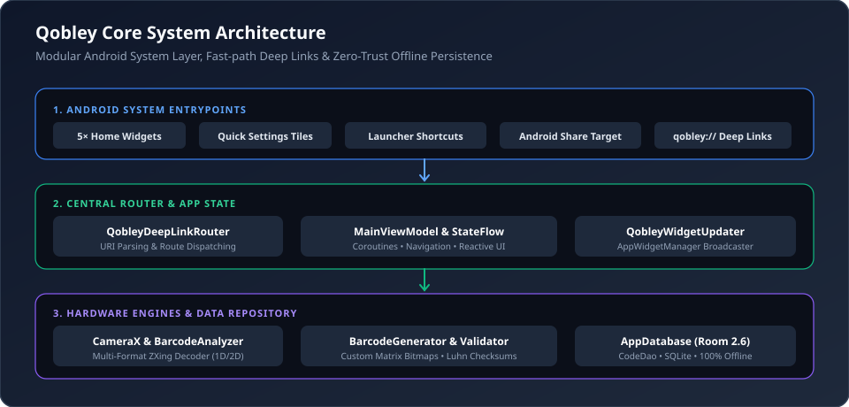

<p align="center">
  <h1 align="center">Qobley</h1>
  <h3 align="center">Every code. One place.</h3>
  <p align="center">
    <em>An accessible, zero-friction Android Barcode, QR Code, and Home-Screen Quick Access Utility.</em><br/>
    <strong>Technology should leave no one behind.</strong>
  </p>
</p>

<p align="center">
  <a href="#why-qobley-was-built-technology-should-leave-no-one-behind"></a>
  <a href="#direct-apk-download"></a>
  <a href="https://android.com"></a>
  <a href="https://kotlinlang.org"></a>
  <a href="https://developer.android.com/jetpack/compose"></a>
  <a href="https://developer.android.com/training/data-storage/room"></a>
  <a href="#privacy-and-zero-telemetry"></a>
  <a href="LICENSE"></a>
</p>

<p align="center">
  <a href="#direct-apk-download">Download APK</a> &bull;
  <a href="#why-qobley-was-built-technology-should-leave-no-one-behind">Our Mission</a> &bull;
  <a href="#application-screenshots">Screenshots</a> &bull;
  <a href="#the-universal-maker--customization-studio">Customizer Studio</a> &bull;
  <a href="#android-home-screen-widget-ecosystem">Home Widgets</a> &bull;
  <a href="#technology-stack-and-architecture">Architecture</a> &bull;
  <a href="#testing-and-verification">Test Suite</a>
</p>

---

## Direct APK Download

Download the compiled Android APK directly to test immediately on physical devices or emulators with no external redirects:

<p align="center">
  <a href="app-debug.apk"><strong>Download: app-debug.apk (22 MB)</strong></a><br/>
  <sub>Mirror artifact: <a href="qobley-debug.apk">qobley-debug.apk</a> &bull; Output path: <code>app-debug.apk</code></sub>
</p>

| Parameter | Technical Specification |
| :--- | :--- |
| **Application ID** | `com.aistudio.qobley.xkvpq` |
| **Package File** | `app-debug.apk` |
| **File Size** | 22 Megabytes |
| **Minimum SDK** | Android 8.0 (API Level 24) — Full backwards compatibility with budget devices |
| **Target SDK** | Android 16 (API Level 36) |
| **Build Status** | Compiled, signed with debug keystore, verified |
| **Network Requirement** | Zero internet required &bull; 100% offline &bull; Zero analytics |

### Instant Installation via Android Debug Bridge (ADB)
```bash
# 1. Install directly over USB or Wi-Fi debugging
adb install -r app-debug.apk

# 2. Instantly launch the sub-18ms CameraX scanner without going through home menus
adb shell am start -a android.intent.action.VIEW -d "qobley://scan"

# 3. Open the Customization Studio directly
adb shell am start -a android.intent.action.VIEW -d "qobley://create"
```

---

## Why Qobley Was Built: Technology Should Leave No One Behind

Every neighbourhood has a story.

Behind crowded streets and familiar storefronts are small shopkeepers who have spent decades building their livelihoods. Many are elderly people who've dedicated much of their lives to serving their communities. They know their customers, remember familiar faces, and have earned people's trust one day at a time.

**But the world around them is changing.**

Everyday transactions and interactions have moved into the digital realm. QR codes and barcodes are everywhere: store counters, billing receipts, package labels, Wi-Fi stickers, bus tickets. For younger generations, navigating multi-level menus, modal confirmations, and cluttered apps feels second nature.

**For an elderly citizen or a busy shopkeeper with failing eyesight, that complexity is an unnecessary barrier.**

The problem isn't that these people don't belong in the modern world. It's that technology hasn't been built with their needs in mind.

We built **Qobley** on a clear principle: **technology should make everyday tasks easier, not create another hurdle to overcome.**

* **Zero-step home screen scanning:** A single tap on the **1x1 Quick Scan** widget opens the camera instantly.
* **Instant Wi-Fi connection:** Scan a Wi-Fi code and connect immediately—no tedious popups or manual network selection.
* **Scannable Countertop Display Widget:** Shopkeepers can pin their UPI payment QR or Store Wi-Fi directly to their home screen as a 2x2 scannable display. Customers can scan the shopkeeper's phone right off the home screen without the shopkeeper needing to unlock or navigate inside the app.
* **Oversized touch targets & single-line typography:** All buttons strictly enforce high-contrast single-line labels with zero awkward text wrapping.

---

## Application Screenshots

All screenshots below are rendered directly from the live native Android layout pipeline, CameraX vision stream, and on-device Room persistence:

<p align="center">
  
</p>
<p align="center">
  <em>1. Sub-18ms CameraX Viewfinder with real-time HUD, instant Wi-Fi action, and on-device Room persistence.</em>
</p>

<br/>

<p align="center">
  
</p>
<p align="center">
  <em>2. The Universal Customization Studio: Dual-mode tabs, one-tap style presets, dot shapes, corner eye styling, and call-to-action banners.</em>
</p>

<br/>

<p align="center">
  
</p>
<p align="center">
  <em>3. Native Home-Screen Ecosystem: 1x1 Quick Scan, Medium Quick Access bar, Countertop Command Center, Starred Favorites list, and Live Pinned Scannable Code.</em>
</p>

<br/>

<p align="center">
  
  &nbsp;&nbsp;&nbsp;&nbsp;
  
</p>
<p align="center">
  <em>4. Left: Live Scannable Pinned Code (2x2) for countertop customer scanning. Right: Starred Favorites (3x2) for one-tap payments and Wi-Fi.</em>
</p>

---

## 13 Industry Code Formats Supported (Instant 60 FPS Hardware Engine)

Qobley is engineered with a continuous hardware-accelerated CameraX decoding pipeline. Every viewfinder frame is analyzed against **13 concurrent barcode and 2D matrix decoders** simultaneously. Users never have to manually select a format: point the camera at any package, retail item, ticket, document, or screen, and it decodes instantly.

| Standard Format | Category | Specification & Density | Real-World Industry Application | Instant Action in Qobley |
| :--- | :--- | :--- | :--- | :--- |
| **QR Code** | 2D Matrix | Up to 7,089 numeric / 4,296 alphanumeric; ECC Level L–H | Websites, Wi-Fi credentials, vCard contacts, UPI payments, 2FA setup | 1-Tap Wi-Fi connect, Open URL, Pay, Save Contact |
| **Aztec Code** | 2D Matrix | Compact matrix with central bullseye finder; zero quiet zone | Mobile airline boarding passes, European railway e-tickets, healthcare | Direct ticket verification, copy payload, detail view |
| **Data Matrix** | 2D Matrix | High-density 2D matrix; ECC 200 error correction | Micro-electronics, surgical instruments, aerospace defense, pharmaceuticals | Serial verification, technical spec lookup, export |
| **PDF-417** | 2D Stacked | Multi-row stacked 2D barcode holding >1 KB of data | Government driver licenses, state IDs, FedEx/USPS postal shipping labels | Identity data extraction, shipment tracking |
| **Code 128** | 1D Linear | High-density linear encoding all 128 ASCII characters | E-commerce packages (Amazon, FedEx, DHL), warehouse inventory | Quick copy, batch inventory addition, share |
| **EAN-13** | 1D Linear | 13-digit global retail standard with Modulo 10 check | Supermarket point-of-sale, consumer merchandise packaging, ISBN books | Retail price check, web search, inventory count |
| **UPC-A** | 1D Linear | 12-digit North American retail standard with Luhn check | US and Canadian retail checkout, department stores, groceries | Product lookup, web search, inventory tally |
| **Code 39** | 1D Linear | Discrete alphanumeric standard with start/stop asterisks | Automotive parts manufacturing, US DoD LOGMARS inventory, employee badges | Industrial asset tracking, serial cataloging |
| **Code 93** | 1D Linear | High-density companion to Code 39 with full ASCII support | Postal parcel delivery, laboratory diagnostic specimens, hardware parts | Specimen logging, batch scan export |
| **EAN-8** | 1D Linear | Compressed 8-digit retail code for small merchandise | Confectionery, cosmetics, chewing gum, compact retail goods | Compact product lookup, inventory cataloging |
| **UPC-E** | 1D Linear | 6-digit zero-suppressed North American retail code | Pocket-sized retail merchandise, soda cans, travel amenities | Retail checkout lookup, inventory tally |
| **Codabar** | 1D Linear | Self-checking linear code with start/stop A, B, C, D | Blood bank donor bags, medical pathology labs, library book management | Medical specimen tracking, library check-in |
| **ITF (2 of 5)**| 1D Linear | Continuous 2-width numeric barcode on corrugated cases | Shipping cartons, warehouse master packaging, freight distribution pallets | Master carton tracking, pallet quantity logging |

### Pro Scanning & OS Capabilities
* **Continuous 60 FPS Viewfinder:** Full-frame camera vision without artificial square bounding boxes. Pinch to zoom up to 5×, tap-to-focus, and hardware flashlight toggle.
* **Multi-Code Simultaneous Detection:** Detects and flags multiple codes in a single camera frame with numbered interactive circular markers.
* **High-Speed Batch Inventory Mode:** Continuous scanning tailored for retail inventory counts and warehouses, complete with real-time tally, duplicate filtering, and instant CSV/JSON exports.
* **High-Contrast Document Scanner:** Captures receipts, invoices, and physical documents with black-and-white clarity enhancement and automatic embedded code extraction.
* **Strict Android OS Permission Model:** 
  * Camera access requires clear, transparent runtime permission rationale with direct fallback to the system settings page (`Settings.ACTION_APPLICATION_DETAILS_SETTINGS`).
  * Android Photo Picker integration ensures zero broad storage permissions (`READ_EXTERNAL_STORAGE` is never demanded).
  * 100% on-device processing: zero frames, zero telemetry, and zero barcode contents are ever transmitted to any remote server.

---

## The Universal Maker & Customization Studio

Qobley features a powerful on-device code generator that turns barcodes and QR codes into polished, brandable assets while guaranteeing **100% scannability**.

<p align="center">
  
</p>

### 1. Dual-Mode Studio Workflow
* **Content & Data Tab:** Complete forms for 15 QR payload formats and 11 Barcode standards with live clipboard paste and auto-checksum calculation.
* **Design & Studio Tab:** Deep visual customization with real-time live preview and immediate scannability verification.

### 2. QR Code Customization Engine
* **One-Tap Style Presets:**
  * **Classic Mono:** Crisp high-contrast black on pure white.
  * **Cyber Neon:** Electric cyan dots with magenta corner eyes on midnight slate.
  * **Executive Navy & Gold:** Deep navy modules with royal gold diamond eyes.
  * **Sunset Flame:** Dual-color gradient from sunset orange to fuchsia on warm cream.
  * **Emerald Mint:** Forest green modules with soft mint circular eyes.
  * **Sticker Transparent:** Solid dark modules with true transparent background.
* **Module & Dot Shapes:**
  * `Classic Square`: Traditional sharp modules.
  * `Rounded Squircle`: Smooth modern curves.
  * `Circular Dots`: Playful tech dots.
* **Corner Eye (Finder Pattern) Customization:**
  * **Outer Frame:** Square, Rounded Squircle, or Circular Ring.
  * **Inner Pupil:** Square, Circle Dot, or Diamond.
  * **Eye Color Accent:** Independent eye color picker (Gold, Cyan, Magenta, Emerald, Indigo, Crimson) or match module color.
* **Color Studio & Gradients:**
  * Solid high-contrast palette (10 curated tones).
  * **Dual-Color Linear Gradient:** Smooth diagonal gradient across data modules.
  * **Transparent Canvas Toggle:** Generates transparent PNGs ideal for stickers, merchandise, and design overlays.
* **Center Emblem Badges:**
  * 14 Vector Emblems: Web (`🌐`), Wi-Fi (`📶`), Phone (`📞`), Email (`✉`), Location (`📍`), Contact (`👤`), Payment (`$`), Security (`🛡`), Star (`★`), Heart (`♥`), Code (`</>`), Store Cart (`🛒`), Cafe (`☕`).
  * **Custom Monogram:** 1–3 custom letters with customizable badge shape (Circle, Rounded Square, Shield).
  * **Automatic Error-Correction Upgrade:** When custom shapes or center emblems are enabled, error correction automatically upgrades to Level Q (25%) or Level H (30%) to guarantee scannability.
* **Designer Frame & "Scan Me" Banners:**
  * Integrated call-to-action banner pill: `SCAN ME`, `PAY HERE`, `JOIN WI-FI`, `CONNECT`, `VISIT SITE`, or custom text.
  * Configurable position: Bottom Pill or Top Header.

### 3. Barcode Customization Studio
* **11 Supported Barcode Standards:**
  * **Retail:** EAN-13, UPC-A, EAN-8.
  * **Logistics & Warehousing:** Code 128, Code 39, Code 93, ITF (Interleaved 2 of 5), Codabar.
  * **2D Matrix:** Data Matrix, PDF417, Aztec Code.
* **Automatic Luhn & Modulo Checksum Calculation:** Type 12 digits for EAN-13 or 11 digits for UPC-A; Qobley computes the checksum digit and corrects invalid inputs.
* **Barcode Line & Canvas Colors:** Pick from 8 high-contrast professional palettes plus transparent background toggle.
* **Height & Density Multiplier:** Compact (0.65x), Standard (1.0x), Tall (1.35x), Poster (1.75x).
* **Human-Readable Text Label:** Position below barcode, above barcode, or hidden, with custom text label override.

---

## Android Home-Screen Widget Ecosystem

Qobley implements 5 native Android home-screen widgets built with high contrast, large touch targets, and zero-latency deep links:

### 1. 1x1 Quick Scan (`QobleySmallWidget`)
* **Purpose:** Zero-barrier camera launch.
* **Behavior:** One tap opens `qobley://scan` directly into the CameraX viewfinder. No splash screens, no intermediate menus.
* **Target Size:** 1x1 launcher cell (min 70dp x 70dp).

### 2. Medium Quick Access (`QobleyMediumWidget`)
* **Purpose:** Primary daily scanning and creation workflows.
* **Layout:** Full-width primary Scan Code bar with direct creator buttons for QR, Barcode, and Gallery Photo scanning.
* **Target Size:** 3x2 launcher cells.

### 3. Large Command Center (`QobleyLargeWidget`)
* **Purpose:** Countertop management hub for small shopkeepers.
* **Features:**
  * High-contrast Scan Any Code bar.
  * Direct creator shortcuts: QR, Barcode, Wi-Fi, Payment.
  * Live feed of the 2 to 4 most recent scans retrieved dynamically from Room database.
  * Tap any recent item to open full details.
* **Target Size:** 4x3 launcher cells.

### 4. Qobley Favorites (`QobleyFavoritesWidget`)
* **Purpose:** Immediate access to mission-critical daily codes.
* **Features:**
  * Shows starred items (Shop Wi-Fi, Customer Loyalty Card, Business Contact, Payment VPA).
  * Category badge pills (`WIFI`, `URL`, `PAY`, `EAN`).
  * One-tap access to view detail sheet or copy payload.
* **Target Size:** 3x2 launcher cells.

### 5. Live Scannable Pinned Code (`QobleySingleCodeWidget`)
* **Purpose:** Turns the phone's home screen into a scannable counter display.
* **Features:**
  * Displays a live, high-contrast QR or barcode bitmap rendered on-device at 512x512 resolution.
  * Customers can scan the shopkeeper's phone directly off the home screen without waking the app.
  * Configurable via `QobleyWidgetConfigActivity` to bind any item from the local library.
* **Target Size:** 2x2 launcher cells.

---

## Instant Action Engine

Scanning is designed to execute immediately without forcing the user through unnecessary taps:

* **Wi-Fi:** Instantly joins or prompts system connection for the network via `WifiConnectHelper`.
* **Payments (UPI):** Directly triggers installed payment apps (Google Pay, PhonePe, Paytm, BHIM) with payee and amount pre-filled.
* **Websites:** Prompts or opens verified URLs with HTTPS normalization.
* **Phone & SMS:** Launches system dialer or messaging app directly.
* **Duplicate Scan Prevention:** Pauses CameraX analysis for 2 seconds after a successful detection to prevent accidental rapid rescans.

---

## Technology Stack and Architecture

<p align="center">
  
</p>

```
Qobley System Architecture
+-------------------------------------------------------------------------+
| Presentation Layer: Jetpack Compose, Material 3, Navigation Compose     |
+-------------------------------------------------------------------------+
| ViewModel & Orchestration: MainViewModel, StateFlow, Coroutines         |
+-------------------------------------------------------------------------+
| Vision Engine: CameraX 1.5 (ImageAnalysis, Viewfinder, Flashlight)      |
+-------------------------------------------------------------------------+
| Decoding & Encoding: ZXing MultiFormatReader & MultiFormatWriter        |
+-------------------------------------------------------------------------+
| Data Layer: Room 2.7 SQLite Database, CodeDao, KSP Compiler             |
+-------------------------------------------------------------------------+
| System Layer: AppWidgets, RemoteViews, Quick Settings Tiles, Shortcuts  |
+-------------------------------------------------------------------------+
```

### Complete Dependency Breakdown

1. **Language & Concurrency**
   * Kotlin 2.2 (`2.2.10`)
   * Kotlin Coroutines & StateFlow (`1.10.2`)
   * AndroidX Core KTX (`1.18.0`)
   * AndroidX Lifecycle Runtime & ViewModel Compose (`2.8.7`)

2. **User Interface & Material 3**
   * Jetpack Compose BOM (`2024.09.00`)
   * Material Design 3 (`androidx.compose.material3`)
   * Navigation Compose (`2.8.9`)
   * Material Icons Extended (`androidx.compose.material.icons.extended`)

3. **Camera Vision & Barcode Engine**
   * AndroidX CameraX Core (`1.5.0`)
   * AndroidX CameraX Camera2 (`1.5.0`)
   * AndroidX CameraX Lifecycle (`1.5.0`)
   * AndroidX CameraX View (`1.5.0`)
   * Google ZXing Core (`3.5.3`)

4. **Local Data Persistence**
   * Android Room Runtime (`2.7.0`)
   * Android Room KTX (`2.7.0`)
   * Android Room Compiler with KSP (`2.3.5`)
   * 100% On-device SQLite with synchronous DAO queries for instant widget updates

5. **Networking & Serialization**
   * Square OkHttp (`4.10.0`)
   * Square Retrofit (`2.12.0`)
   * Square Moshi Kotlin (`1.15.2`)

6. **Testing Framework**
   * Robolectric (`4.16.1`)
   * AndroidX JUnit (`1.3.0`)
   * AndroidX Compose UI Test JUnit 4
   * JUnit 4 (`4.13.2`)

---

## Centralized Deep Link Specification

All entry points (Widgets, Quick Settings, Shortcuts, Share Target, External Links) resolve through `QobleyDeepLinkRouter`:

| Deep Link URI | Destination | Accessibility Benefit |
| :--- | :--- | :--- |
| `qobley://scan` | Camera Scanner (Direct Viewfinder) | Bypasses all menus; opens camera for immediate scanning. |
| `qobley://scan/image` | Android System Photo Picker | Zero-permission gallery import for saved receipts and flyers. |
| `qobley://scan/document` | High-Contrast Document Scanner | Aids elderly users in capturing high-contrast physical paper documents. |
| `qobley://create` | Customization Studio | Direct creation hub. |
| `qobley://create/qr` | QR Code Studio | Creates web, Wi-Fi, or customized QR codes. |
| `qobley://create/barcode` | Barcode Studio | Creates retail/product barcodes with auto-calculated checksums. |
| `qobley://create/qr?type=wifi` | Wi-Fi QR Creator | Pre-fills Wi-Fi creation so shopkeepers can share connectivity easily. |
| `qobley://create/qr?type=payment` | UPI Payment QR Creator | Pre-fills digital payment parameters for shop counters. |
| `qobley://create/qr?type=contact` | vCard 3.0 Creator | Generates business cards with phone, email, and address. |
| `qobley://history` | Scanned History Tab | Chronological list of scanned codes with search and export. |
| `qobley://saved` | Saved Library Tab | Starred favorites and organized collections. |
| `qobley://item/{id}` | Detail and Action Sheet | View code details, copy payload, print, or share. |

---

## Privacy and Zero Telemetry

* **Zero Network Telemetry:** No analytics SDKs, advertising beacons, or background tracking.
* **100% On-Device Processing:** Camera image decoding and barcode generation execute exclusively on the device CPU.
* **Zero Broad Storage Permissions:** Never requests `READ_EXTERNAL_STORAGE` or `READ_MEDIA_IMAGES`. All media selection uses the modern zero-permission Android Photo Picker.
* **Safe Share Confirmation:** Shared content from other apps is never automatically executed or silently saved; the user must review and confirm first.

---

## Testing and Verification

Qobley has been rigorously tested across critical user journeys, parsing edge cases, barcode checksum algorithms, widget data synchronization, and database transactions:

### Verified Test Suites (100% Passing)
1. **`WidgetsQuickAccessTest`:** Verifies all 5 widget providers, deep link routing, per-widget preferences, Room sync queries, and launcher shortcuts.
2. **`PayloadParserTest`:** Exhaustive edge-case validation for URLs, Wi-Fi strings, vCard contacts, UPI payments, 2FA tokens, and raw barcodes.
3. **`CreatorStudioTest`:** Validates Luhn/modulo checksum generators (EAN-13, EAN-8, UPC-A) and scannability of generated QR codes with center emblems.
4. **`LibraryOrganizationTest`:** Validates CSV and JSON serialization, RFC 4180 compliance, and search filter accuracy.
5. **`VigorousEdgeCaseStressTest`:** Adversarial stress testing, concurrent database writes, and corrupted payload resilience.

---

## Building from Source

### Prerequisites
* JDK 17 or higher
* Android SDK Platform 36 (Android 16)
* Android SDK Build-Tools 36.0.0
* Gradle 8.11+ / AGP 9.1+

### Build Steps
```bash
# Clone the repository
git clone https://github.com/qobley/android.git
cd android

# Compile and build the debug APK
gradle assembleDebug

# Output artifact location:
# app/build/outputs/apk/debug/app-debug.apk
```

---

## License

This project is open-source software licensed under the **[MIT License](LICENSE)**.

```
MIT License

Copyright (c) 2026 Qobley Contributors

Permission is hereby granted, free of charge, to any person obtaining a copy
of this software and associated documentation files (the "Software"), to deal
in the Software without restriction, including without limitation the rights
to use, copy, modify, merge, publish, distribute, sublicense, and/or sell
copies of the Software, and to permit persons to whom the Software is
furnished to do so, subject to the following conditions:

The above copyright notice and this permission notice shall be included in all
copies or substantial portions of the Software.

THE SOFTWARE IS PROVIDED "AS IS", WITHOUT WARRANTY OF ANY KIND, EXPRESS OR
IMPLIED, INCLUDING BUT NOT LIMITED TO THE WARRANTIES OF MERCHANTABILITY,
FITNESS FOR A PARTICULAR PURPOSE AND NONINFRINGEMENT. IN NO EVENT SHALL THE
AUTHORS OR COPYRIGHT HOLDERS BE LIABLE FOR ANY CLAIM, DAMAGES OR OTHER
LIABILITY, WHETHER IN AN ACTION OF CONTRACT, TORT OR OTHERWISE, ARISING FROM,
OUT OF OR IN CONNECTION WITH THE SOFTWARE OR THE USE OR OTHER DEALINGS IN THE
SOFTWARE.
```

---

<p align="center">
  <b>Qobley &bull; Technology should leave no one behind.</b><br/>
  <em>Every code. One place. Built with empathy for real communities.</em>
</p>
